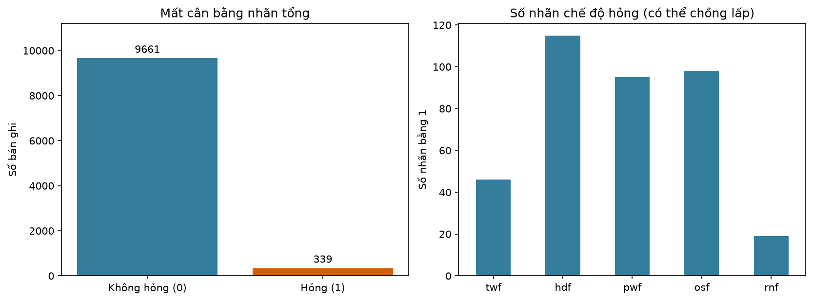
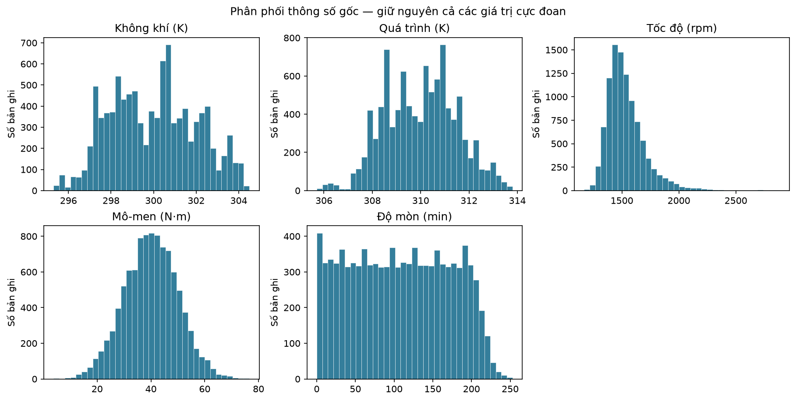
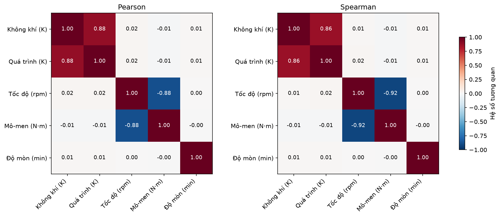
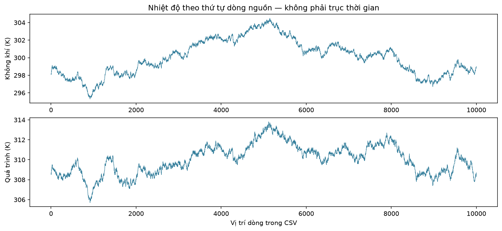

# Kiểm tra chất lượng và khám phá dữ liệu AI4I

Ngày kiểm tra: 29/10/2026. Phạm vi: toàn bộ CSV nguồn, chưa chia tập hoặc học mô hình.
Đây là hồ sơ bằng chứng kỹ thuật phục vụ nhóm kiểm chứng và viết báo cáo, chưa phải nội dung báo cáo cuối đã được thành viên rà soát.

## Chạy lại

Tải CSV theo [hướng dẫn nguồn](../datasets/README.md), cài môi trường theo README rồi chạy từ gốc repository:

```powershell
.\.venv\Scripts\python.exe scripts/run_quality.py
.\.venv\Scripts\python.exe -m unittest discover -s tests -v
```

Hoặc mở lần lượt [notebook chất lượng](../notebooks/01-data-quality.ipynb) và [notebook khám phá](../notebooks/02-eda-features.ipynb), chọn Python trong `.venv`, Restart & Run All. Cả hai gọi cùng hàm tại [quality.py](../src/maintenance/quality.py).

Code đối chiếu SHA-256 với manifest trước khi phân tích và không sửa nguồn. Nếu file nguồn thiếu, sai hash, sai header hoặc sai số trường, dừng với lỗi. Lỗi ô thiếu/kiểu/miền được hàm audit ghi nhận; phần thống kê chỉ tiếp tục khi không có các lỗi này. Bộ kiểm tra hiện tại dùng cho nguồn AI4I tham chiếu, chưa phải adapter dữ liệu mới.

## Kiểm tra cơ bản

| Kiểm tra | Kết quả |
|---|---:|
| Số dòng × cột | 10.000 × 14 |
| Ô thiếu, sai kiểu, sai miền phân loại/nhị phân | 0 |
| UDI trùng | 0 |
| Dòng trùng toàn bộ | 0 |
| Dòng trùng trên cả sáu đầu vào | 0 |
| Nhãn hỏng tổng = 1 | 339 (3,39%) |
| Nhãn hỏng tổng = 0 | 9.661 (96,61%) |

Bằng chứng: [summary.json](../reports/tables/quality/summary.json), [audit theo cột](../reports/tables/quality/column_audit.csv). Không có missing hoặc duplicate không đồng nghĩa dữ liệu không có vấn đề. Chưa chứng nhận được mọi số đo là chính xác về vật lý chỉ từ schema.

## Vấn đề và rủi ro có bằng chứng

| Mã | Quan sát thực tế | Ảnh hưởng | Quyết định ở bước này |
|---|---|---|---|
| Q01 — Mất cân bằng | 339 nhãn hỏng, 9.661 không hỏng; tỷ lệ hỏng 3,39% | Dự đoán tất cả không hỏng vẫn đạt accuracy 96,61%, nhưng không tìm được ca hỏng nào | Không dùng accuracy làm bằng chứng chính; giữ Precision/Recall/F1, chỉ số xếp hạng và baseline phù hợp. Đây là phép tính mô tả, chưa chạy baseline mô hình |
| Q02 — Nhãn không nhất quán | 9 dòng có nhãn tổng = 1 nhưng mọi mode = 0; 18 dòng có tổng = 0 nhưng có mode = 1 | Không thể coi phép OR các mode là nhãn tổng tương đương; diễn giải loại hỏng có giới hạn | Giữ nguyên sáu nhãn; ghi cờ để truy vết, chưa xác định cột nào đúng/sai, không tự sửa/xóa |
| Q03 — Nhãn mode chồng lấp | 24 dòng có từ hai mode trở lên | Ép mode thành các lớp loại trừ nhau sẽ mất thông tin | Giữ multi-label; họ phụ dự kiến dùng nhãn tổng nhị phân, mode phục vụ phân tích riêng |
| Q04 — Phụ thuộc thứ tự nguồn | Tự tương quan lag 1: nhiệt độ không khí 0,9994; quá trình 0,9985; độ mòn 0,9306 | Chia ngẫu nhiên có thể đặt trạng thái gần nhau ở cả train/test, làm đánh giá ít phản ánh dịch chuyển điều kiện | Ghi yêu cầu xem xét giao thức theo khối/thứ tự và so sánh độ nhạy tại việc 5; chưa tự chốt split. Thứ tự không được quy đổi thành thời gian |
| Q05 — Giới hạn truy vết và thời gian | 14 cột không có timestamp hoặc mã máy được xác nhận; Product ID là mã sản phẩm | Không đo được thời gian báo trước hỏng theo máy hoặc điều động tới máy thật | Chỉ kết luận về trạng thái vận hành mô phỏng và ưu tiên bản ghi |
| Q06 — Ca hỏng tập trung theo vị trí nguồn (bổ sung 30/10/2026) | Chia 10 khối 1.000 dòng theo thứ tự nguồn: tỷ lệ hỏng 2,3/2,9/2,2/2,7/**13,4**/2,0/2,3/2,2/1,7/2,2%. Khối 4.001–5.000 có 134/339 ca hỏng. 108/115 ca HDF nằm trong khối này, 7 ca ở khối 3.001–4.000, 0 ca ở các khối còn lại | Giao thức chính: train có 4,25% hỏng, validation 2,26%, test 2,00%; validation và test chính không có ca HDF nào nên không đánh giá được HDF và việc chọn cấu hình bằng validation chưa từng gặp HDF. Trong dữ liệu hiện tại, giao thức phân tầng có HDF train/validation/test = 67/22/26; stratify theo nhãn tổng không tự bảo đảm bao phủ từng mode | Giữ nguyên nhãn và split đã khóa. Nêu trong báo cáo khi diễn giải chênh lệch train/test và khi nói về loại hỏng HDF; không đổi split sau khi đã xem test v1 |

Q01/Q02 là vấn đề dữ liệu/nhãn; Q03 là cấu trúc nhãn phải xử lý đúng, Q04 và Q06 là rủi ro phụ thuộc/phân bố theo vị trí nguồn, Q05 là giới hạn tính phù hợp. Không gọi mọi mục là lỗi dữ liệu cần xóa. Không cộng 9 + 18 + 24 thành tổng bản ghi lỗi, vì nhóm bất nhất và nhóm nhiều mode có thể giao nhau.

Danh sách ID có cờ được tạo local tại `artifacts/metrics/quality/label_flags.csv`, không đưa dữ liệu cấp bản ghi lên Git. Các thống kê tổng hợp đủ để kiểm tra trên repository; chạy lại sẽ tái tạo bằng chứng chi tiết.



Bổ sung Q06 đã có bảng tái tạo và hậu kiểm score: [HDF_SUPPLEMENT_V1.md](HDF_SUPPLEMENT_V1.md). Không sửa module quality.py đã nằm trong hash huấn luyện; dùng script audit bổ sung riêng.

## Phân phối và quan hệ thông số

- Năm cột đo có phân phối/thang đo khác nhau. Bảng [thống kê số](../reports/tables/quality/numeric_summary.csv) gồm count, mean, std, min, các tứ phân vị và max; chưa fit scaling.
- Quy tắc đánh dấu ngoài `[Q1 − 1,5×IQR, Q3 + 1,5×IQR]` đánh dấu 418 giá trị tốc độ và 69 giá trị mô-men. Đây là số cờ từng cột, không phải tổng bản ghi sai hoặc số hỏng; chưa xóa/winsorize bất kỳ giá trị nào. Xem [bảng IQR](../reports/tables/quality/iqr_flags.csv).
- Pearson giữa hai nhiệt độ khoảng 0,8761; giữa tốc độ và mô-men khoảng −0,8750. Spearman giúp đối chiếu quan hệ đơn điệu, không chứng minh nhân quả hoặc tự chứng minh quan hệ phi tuyến. Tương quan gần 0 không chứng minh độc lập. Các biến vật lý sẽ được tính/đánh giá riêng ở bước sau.
- Type H/M/L có lần lượt 1.003/2.997/6.000 bản ghi, 21/83/235 nhãn hỏng. Đây là mô tả nguồn trong [bảng theo Type](../reports/tables/quality/by_type.csv), chưa chứng minh mô hình công bằng hoặc khác biệt do Type gây ra.







### Ghi chú về Q06 và quy tắc sinh nhãn

Q06 được bổ sung sau khi rà soát, bằng cách đếm nhãn theo khối 1.000 dòng trực tiếp từ CSV nguồn; chưa có hàm tương ứng trong `quality.py` nên bảng chưa được sinh tự động và cần được thêm nếu đưa vào báo cáo cuối. Thứ tự nguồn không phải thời gian, nên không diễn giải khối này như một giai đoạn hỏng thật.

Đối chiếu thêm: quy tắc HDF (chênh nhiệt < 8,6 K và tốc độ < 1.380 rpm) và PWF (công suất < 3.500 W hoặc > 9.000 W) khớp nhãn HDF/PWF ở 10.000/10.000 dòng. Ngưỡng lấy từ mô tả sinh dữ liệu của AI4I, không được dùng làm feature hay để tạo nhãn trong dự án. Hệ quả cho diễn giải: nhãn gần như xác định bởi các biến vật lý, và Logistic Regression là mô hình tuyến tính nên khó biểu diễn ngưỡng hai phía của công suất; AP của họ phụ không phải trần của dữ liệu.

## Giới hạn đánh giá và bàn giao

Đã xem cấu trúc, thống kê toàn nguồn, tính nhất quán nhãn và số đếm theo Type trước khi có split. Phải khai báo điều này; không mô tả test tương lai là tập chưa từng được tiếp cận ở mọi mức. Bước này không so sánh phân phối feature theo nhãn, tối ưu mô hình, chọn ngưỡng hoặc đánh giá khả năng phân biệt hỏng/bình thường. Các phân tích phục vụ chọn mô hình/biến và ngưỡng chỉ được làm trên phần phát triển sau khi chốt giao thức; tập test chưa được tạo ở đây.

Đầu ra gồm hai notebook, module dùng chung, lệnh chạy, bảng tổng hợp và bốn hình. Không có split, dữ liệu làm sạch, mô hình, kết quả cảnh báo hay dashboard Superset. Việc tiếp theo là quyết định tiền xử lý có lý do, giữ nguyên nhãn nguồn và tránh loại bỏ đối tượng bất thường trước khi phát hiện chúng.
