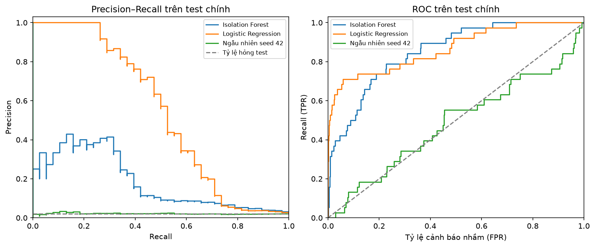
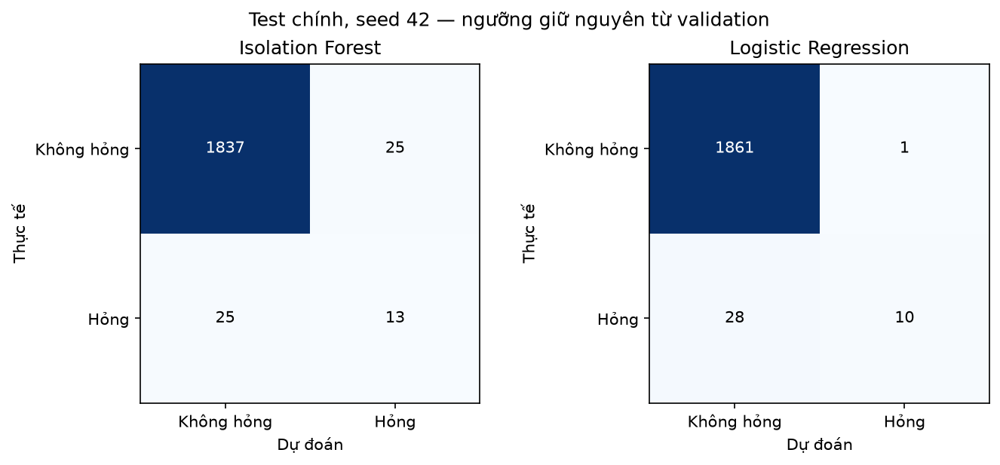
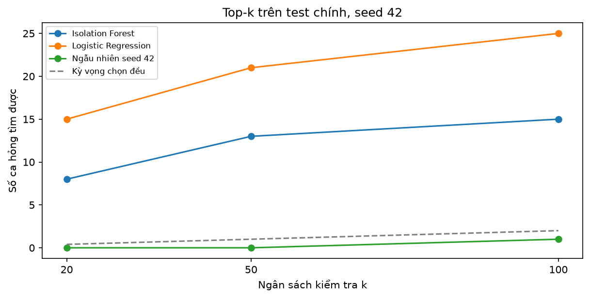

# Đánh giá cuối trên test — v1

Ngày thực hiện: 29/10/2026. Đã chấm test bằng model/ngưỡng chọn từ validation. Không fit lại, không chọn ngưỡng lại hoặc đổi cách chia theo điểm test. Đây là hồ sơ kỹ thuật, chưa phải báo cáo cuối đã được thành viên rà soát.

## Khóa lựa chọn và phạm vi đánh giá

Trước khi gọi loader test, runner xác minh config, mã nguồn, phiên bản thư viện/nguồn/split, score validation và hash model của cả hai họ. Sau đó lưu [evaluation-lock.json](../data/metadata/evaluation-lock.json), gồm cấu hình đánh giá, tất cả run/threshold và tham chiếu lựa chọn. Không chỉ khóa riêng mô hình cho điểm cao hơn.

Chấm 20 run: mỗi giao thức có Isolation Forest ba seed, random ba seed, always_normal ba seed và Logistic Regression seed42. Giữ seed42 là chính; seed43/44 chỉ đo dao động thuật toán/baseline. Logistic Regression lbfgs có một run, không tạo std giả bằng đổi seed.

[configs/evaluation.json](../configs/evaluation.json) đặt trước khi chấm: k=20/50/100, 500 lần bootstrap khối 100 dòng/seed42 trên test chính cho AP/ROC và chênh lệch AP ghép cặp. Không điều chỉnh từ kết quả test. Khoảng đệm của split và kích thước khối bootstrap cùng là 100 nhưng phục vụ hai mục đích khác nhau, không suy ra cả hai đã được tối ưu hoặc bảo đảm độc lập.

Khóa quyết định gốc không ghi đè. Khi tái lập, hash model hiện tại phải khớp manifest validation hiện tại; hash binary joblib có thể khác khi tạo lại, không coi đó là thay đổi lựa chọn nếu các quyết định/run/score validation vẫn trùng. Kiểm tra vẫn chặn đổi ngưỡng, config, split, code hoặc score. Hash manifest đầu vào gốc được giữ trong khóa để truy vết lần đánh giá đầu; khóa là rào chắn quy trình, không phải cơ chế bảo mật.

Các lần chạy lại notebook/script chỉ xác minh cùng mô hình cố định, không phải những lần kiểm tra độc lập mới. Dữ liệu đã tiếp cận qua audit toàn nguồn trước đó; phạm vi độc lập được tuyên bố là test không dùng để chọn mô hình/ngưỡng/feature, không phải hoàn toàn chưa được nhìn ở mọi mức.

## Kết quả test chính, seed42

1.900 bản ghi, 38 ca hỏng (2%). Bảng dưới tính từ [primary-seed.csv](../reports/tables/test/primary-seed.csv).

| Chỉ số | Isolation Forest | Logistic Regression |
|---|---:|---:|
| Average Precision | 0,1813 | 0,5368 |
| ROC-AUC | 0,8531 | 0,8679 |
| Ca hỏng tìm được top20 | 8 | 15 |
| Ca hỏng tìm được top50 | 13 | 21 |
| Ca hỏng tìm được top100 | 15 | 25 |
| Precision@50 | 26,00% | 42,00% |
| Recall@50 | 34,21% | 55,26% |
| TP/FP/FN/TN ở ngưỡng validation | 13/25/25/1.837 | 10/1/28/1.861 |
| Precision ở ngưỡng validation | 34,21% | 90,91% |
| Recall ở ngưỡng validation | 34,21% | 26,32% |
| F1 ở ngưỡng validation | 0,3421 | 0,4082 |

**Không trộn chính sách:** top50 Logistic Regression có 21 TP, 29 FP, 17 FN và 1.833 TN. Nhưng ngưỡng F1 chọn trên validation chỉ tạo 11 cảnh báo trên test, 10 đúng/1 sai và bỏ sót 28 ca. Precision ngưỡng cao không có nghĩa đã tìm hầu hết ca hỏng; không lấy 90,91% làm Precision@50. Ngưỡng được giữ nguyên dù recall test thấp.

So với validation chính, top50 Isolation Forest từ 15 xuống 13, Logistic Regression từ 25 xuống 21. AP Isolation Forest giảm từ 0,3202 xuống 0,1813; AP Logistic Regression tăng từ 0,5011 lên 0,5368. Không phải mọi chỉ số đều phải giảm khi sang test; chúng đo các khía cạnh khác nhau và quần thể thay đổi. Không chỉnh cấu hình sau các quan sát này.

Random seed42 có AP 0,0211, ROC-AUC 0,4841, top20/50/100 tìm 0/0/1 ca. Kỳ vọng chọn đều ở k=50 là 50×0,02=1 ca; một lần random tìm 0 không có nghĩa kỳ vọng 0. Always_normal không cảnh báo, bỏ sót cả 38 ca; accuracy của nó là 98% nhưng recall bằng 0. Không báo top-k cho baseline không có xếp hạng.







## Test phụ: kiểm tra độ nhạy với cách chia

Test ngẫu nhiên phân tầng có 2.000 bản ghi, 68 ca hỏng. Seed42: Isolation Forest AP 0,1736, ROC-AUC 0,8365, top50 tìm 11 ca (P@50=22%, Recall@50≈16,18%). Logistic Regression AP 0,4522, ROC-AUC 0,9235, top50 tìm 27 ca (P@50=54%, Recall@50≈39,71%).

Không chọn test phụ vì có chỉ số đẹp hơn. Cấu hình mỗi giao thức đã chọn bằng validation riêng trước khi chấm; các giao thức chồng lấp dữ liệu giữa nhau, không phải hai nguồn kiểm tra độc lập. Giữ giao thức theo thứ tự nguồn làm chính theo thiết kế.

## Phân tích sai sót ban đầu

Các bảng [groups.csv](../reports/tables/test/groups.csv) dùng chính thứ hạng top50 toàn tập, không xếp lại hoặc cấp 50 lượt mới trong từng nhóm. Các số TP/FP/FN/TN của nhóm ứng với ngưỡng cố định, còn global_top50_hits/recall ứng với top50 — phải đọc đúng chính sách.

Ở Logistic Regression, test chính:

- Type L có 1.117 dòng/31 ca hỏng: ngưỡng tìm 6, bỏ sót 25; top50 toàn tập tìm 15 ca thuộc nhóm.
- Type M có 573 dòng/7 ca hỏng: ngưỡng tìm 4, bỏ sót 3; top50 toàn tập tìm 6 ca thuộc nhóm.
- Type H có 210 dòng nhưng không có ca hỏng: recall không xác định, không ghi 0/1 hoặc kết luận công bằng với nhóm H.
- Mode TWF có 10 dòng mang nhãn hỏng tổng: ngưỡng không tìm được ca nào; top50 toàn tập chỉ tìm 1. Đây là giới hạn cần nêu, không che bằng precision chung cao.
- Test chính không có dòng mang mode HDF/RNF, nên chưa đánh giá được khả năng phát hiện các mode này trên test đó.

Mode có thể chồng lấp, không cộng số mode thành tổng ca hỏng. Phân nhóm mode dùng nhãn hậu kiểm, không đưa vào xếp hạng hoặc lọc trước khi chọn danh sách. Các diễn giải trên là quan sát, chưa xác định nguyên nhân gây lỗi; phân tích sâu và tái lập độc lập còn có thể bàn giao cho thành viên.

Bổ sung 30/10: hậu kiểm HDF ở [HDF_SUPPLEMENT_V1.md](HDF_SUPPLEMENT_V1.md) dùng score đã lưu, không thay bảng/model/ngưỡng v1. Test chính không có HDF; test phân tầng có 26 HDF, top50 IF chọn 0, LR chọn 10. Phát biểu hiệu quả phải nêu rõ mode/phạm vi/chính sách.

## Độ dao động và giới hạn suy luận

[seed_summary.csv](../reports/tables/test/seed_summary.csv) có count/mean/std theo seed trong cùng split. Các seed không tạo thêm tập dữ liệu độc lập. Std Logistic Regression để trống vì chỉ có một run, không thay bằng 0 rồi coi như chắc chắn ổn định.

[bootstrap.csv](../reports/tables/test/bootstrap.csv) dùng cùng các khối được lấy lại cho cả hai mô hình, giữ ghép cặp trên cùng mẫu. 500/500 lần có đủ hai lớp. Khoảng percentile 2,5–97,5% thăm dò:

| Đại lượng | Khoảng percentile |
|---|---|
| AP Isolation Forest seed42 | 0,1275–0,2947 |
| AP Logistic Regression | 0,3846–0,6840 |
| AP Logistic Regression − AP Isolation Forest | 0,1626–0,4955 |

Đây không phải bảo đảm khoảng tin cậy 95% có coverage đúng: khối 100 chưa được chứng minh độc lập, chỉ có 19 khối, nguồn mô phỏng và 38 ca hỏng. Không tuyên bố kiểm định ý nghĩa thống kê hoặc ưu thế nhân quả chỉ từ khoảng này. Không tính bootstrap top-k bằng các ID trùng sau lấy mẫu lại; phần này chỉ kiểm tra AP/ROC và chênh AP.

Logistic Regression có lợi thế xếp hạng trên test hiện tại theo thiết kế, nhưng hai thuật toán/lưới tìm khác nhau (4 so với 16 cấu hình), cả hai dùng nhãn validation chọn; chênh lệch không cô lập tác động thuần của cung cấp nhãn. Dữ liệu không có lịch sử máy/thời gian thật nên chưa chứng minh thời gian báo trước, hiệu quả tiền bạc hoặc an toàn nhà máy.

## Tái lập và sản phẩm

```powershell
.\.venv\Scripts\python.exe scripts/evaluate_test.py
.\.venv\Scripts\python.exe -m unittest discover -s tests -v
```

Cần model/score validation local đúng phiên bản, metadata split và các config đã khóa. Nếu dựng lại từ đầu, chạy các bước chuẩn bị và train/validation đúng config trước, rồi kiểm tra khóa quyết định; không đổi cấu hình theo kết quả test đã công bố. Chỉ nạp joblib do quy trình dự án tạo và đã xác minh hash. Không xóa khóa để cho cấu hình mới chạy qua và gọi nó là đánh giá độc lập.

[04-evaluation.ipynb](../notebooks/04-evaluation.ipynb) gọi cùng [final_evaluation.py](../src/maintenance/final_evaluation.py). Các bảng tại reports/tables/test/ gồm metrics, primary-seed, groups, seed_summary, bootstrap và manifest. Bảng/hình tổng hợp lên Git; điểm test không chứa nhãn thật tại artifacts/scores/test/, bảng lỗi có nhãn tại artifacts/metrics/test-errors/, chỉ giữ local và tạo lại bằng lệnh.

[manifest.json](../reports/tables/test/manifest.json) lưu test_evaluated=true, refit=false, ngưỡng từ validation và hash các file điểm/lỗi. Ngày đánh giá này đóng phiên bản v1: sau khi xem lỗi test, cải tiến mới cần thiết kế kiểm chứng mới phù hợp; không dùng lại test cũ để tối ưu rồi gọi đó là độc lập.
