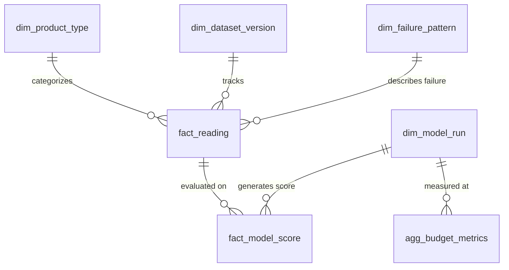

# TÀI LIỆU THIẾT KẾ & VẬN HÀNH KHO DỮ LIỆU POSTGRESQL
## Đề tài 16: Khai thác Dữ liệu Bảo trì Dự đoán Thiết bị

* **Người phụ trách:** Quốc Việt (Vai trò: `QV`)
* **Ngày cập nhật:** 02/11/2026
* **Trạng thái:** Đã hoàn thành thiết kế Star Schema và cấu hình hạ tầng Docker Compose.

---

## 1. Kiến trúc Kho Dữ liệu & Mô hình Star Schema

### 1.1. Nguyên lý Thiết kế & Giải quyết Vấn đề Grain Mismatch
Trong bài toán bảo trì dự đoán với dữ liệu AI4I 2020:
* Tập dữ liệu gốc có **10.000 bản ghi cảm biến** (`readings.csv`).
* Quá trình đánh giá mô hình tạo ra **78.000 điểm dự đoán** (`scores.csv`), tương ứng với 20 mô hình chấm điểm trên các tập Validation và Test.

Nếu gộp chung cảm biến và điểm mô hình vào một bảng duy nhất, dữ liệu cảm biến sẽ bị nhân bản nhiều lần (mỗi bản ghi cảm biến bị lặp lại theo số mô hình đánh giá trên tập đó), dẫn đến sai lệch nghiêm trọng khi thực hiện các phép tính tổng (`SUM`), đếm (`COUNT`), hoặc tính toán tỷ lệ.

**Giải pháp kiến trúc:** Tách bạch rõ ràng thành **2 Bảng Fact** và **4 Bảng Dimension**:
1. **`fact_reading` (Grain: 1 quan sát cảm biến thực tế):** Có đúng 10.000 dòng, lưu trữ toàn bộ số đo cảm biến gốc và 3 đặc trưng vật lý tính toán (`temperature_difference_k`, `power_w`, `wear_torque_min_nm`).
2. **`fact_model_score` (Grain: 1 lần mô hình chấm điểm 1 quan sát):** Có đúng 78.000 dòng (`model_run_id × split × reading_id`), lưu trữ điểm ưu tiên `priority_score`, thứ hạng `priority_rank`, và dự đoán nhị phân `predicted_failure`.
3. **`agg_budget_metrics` (Bảng tổng hợp chỉ số theo ngân sách):** Có đúng 120 dòng (`model_run_id × split × budget_k`), phục vụ trực quan hóa các đường cong đánh đổi ngân sách siêu tốc trên Superset.

### 1.2. Danh mục các Bảng Dimension (Chiều phân tích)
* **`dim_product_type`:** Chứa 3 phân loại biến thể sản phẩm (L - Low, M - Medium, H - High) theo tài liệu gốc của UCI.
* **`dim_dataset_version`:** Chứa thông tin xuất xứ dữ liệu, URL nguồn UCI, SHA-256 xác thực và phiên bản schema `ai4i-v1`.
* **`dim_failure_pattern`:** Chiều phân tích dạng hỏng hóc, lưu trữ các tổ hợp nhãn hỏng (TWF, HDF, PWF, OSF, RNF) và cờ đa nhãn (`is_multilabel`). Bảng này giúp phân tích sâu hậu kiểm mà không làm nhân đôi số dòng khi một thiết bị gặp nhiều sự cố đồng thời.
* **`dim_model_run`:** Lưu trữ metadata của 20 lần chạy mô hình (họ mô hình, seed, bộ đặc trưng, giao thức chia tập, và ngưỡng phân loại tối ưu `threshold`).

> [!IMPORTANT]
> **Tuân thủ quy chuẩn dữ liệu ([DATA_CONTRACT.md](DATA_CONTRACT.md)):**
> * Không tạo bảng `dim_machine` từ `product_id` (AI4I không có mã máy riêng lẻ).
> * Không tạo bảng `dim_date` từ `reading_id / UDI` (UDI chỉ là thứ tự bản ghi, không phải timestamp thời gian thực).

---

## 2. Sơ đồ Quan hệ Thực thể (ERD Star Schema)

Sơ đồ ERD chi tiết được lưu trữ tại [docs/diagrams/warehouse.mermaid](diagrams/warehouse.mermaid):



---

## 3. Hạ tầng Dịch vụ Docker Compose Cục bộ (`infra/`)

Hệ thống được đóng gói hoàn toàn trong [infra/docker-compose.yml](../infra/docker-compose.yml), chạy cục bộ 100% không phụ thuộc cloud hay bên thứ ba.

### 3.1. Các Dịch vụ Thành phần
1. **`postgres` (Container: `pm_postgres`):**
   * Hình ảnh: `postgres:16-alpine` (cố định phiên bản, dung lượng nhẹ, bảo mật cao).
   * Cổng xuất: `5432:5432`.
   * Khởi tạo đa cơ sở dữ liệu qua [infra/postgres/init-multiple-dbs.sh](../infra/postgres/init-multiple-dbs.sh):
     * `maintenance_dw`: Cơ sở dữ liệu Kho chứa Star Schema và dữ liệu phân tích.
     * `superset_metadata`: Cơ sở dữ liệu riêng chứa metadata cấu hình của Apache Superset.
   * Healthcheck tự động: Kiểm tra `pg_isready` mỗi 5 giây.
   * Volume lưu trữ bền vững: `pm_postgres_data`.
2. **`superset` (Container: `pm_superset`):**
   * Hình ảnh: `apache/superset:4.0.2` (phiên bản ổn định).
   * Cổng xuất: `8088:8088`.
   * Cấu hình nâng cao qua [infra/superset/superset_config.py](../infra/superset/superset_config.py):
     * Kích hoạt `DASHBOARD_NATIVE_FILTERS`.
     * Cấu hình `ROW_LIMIT = 100000` để truy vấn trọn vẹn 78.000 dòng `scores`.
     * Tắt Talisman SSL ép buộc để tương thích môi trường local HTTP.
   * Volume lưu trữ bền vững: `pm_superset_home`.
3. **`superset-init` (Container: `pm_superset_init`):**
   * Service chạy một lần (`restart: "no"`) để tự động:
     1. Nâng cấp schema metadata (`superset db upgrade`).
     2. Tạo tài khoản quản trị viên mặc định (`admin / admin123`).
     3. Khởi tạo quyền và vai trò mặc định (`superset init`).

### 3.2. Hướng dẫn Vận hành Hạ tầng
Từ thư mục gốc dự án:

```powershell
# 1. Khởi động toàn bộ stack (PostgreSQL + Superset)
cd infra
docker compose up -d

# 2. Kiểm tra trạng thái các container
docker compose ps

# 3. Theo dõi log khởi tạo Superset
docker compose logs -f superset-init

# 4. Dừng hạ tầng (dữ liệu trong volumes vẫn được bảo toàn)
docker compose down
```

---

## 4. Kế hoạch Bộ 5 Script SQL (Triển khai ở Giai đoạn 3)

| Tên File | Vai trò nghiệp vụ | Cơ chế đảm bảo chất lượng |
|---|---|---|
| `sql/01-staging.sql` | DDL tạo 8 bảng staging ánh xạ trực tiếp từ 8 file CSV `handoff-v1`. | Kiểm tra kiểu dữ liệu, ràng buộc NOT NULL cho các khóa chính. |
| `sql/02-star-schema.sql` | DDL tạo 4 Dimension, 2 Fact, 1 Agg Table. | Ràng buộc PK/FK, CHECK constraints, Indexes trên reading_id, model_run_id, partition, priority_rank. |
| `sql/03-transform-load.sql` | Chuyển đổi và nạp từ Staging sang Star Schema. | Idempotent (`ON CONFLICT DO NOTHING`), chạy nhiều lần không nhân đôi dòng. |
| `sql/04-olap.sql` | 4 truy vấn OLAP nghiệp vụ sâu sắc. | So sánh IF vs LR ở cùng ngân sách k, Roll-up theo Type, Slice & Dice Split/Partition, Phân tích đa nhãn. |
| `sql/05-reconciliation.sql` | Đối soát tự động toàn bộ số liệu. | Kiểm tra 10.000 readings, 78.000 scores, 339 hỏng, LR top-50 = 21 TP, IF top-50 = 13 TP. |

